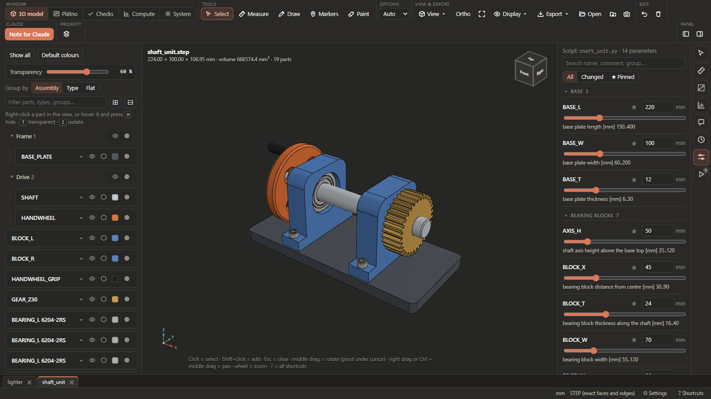
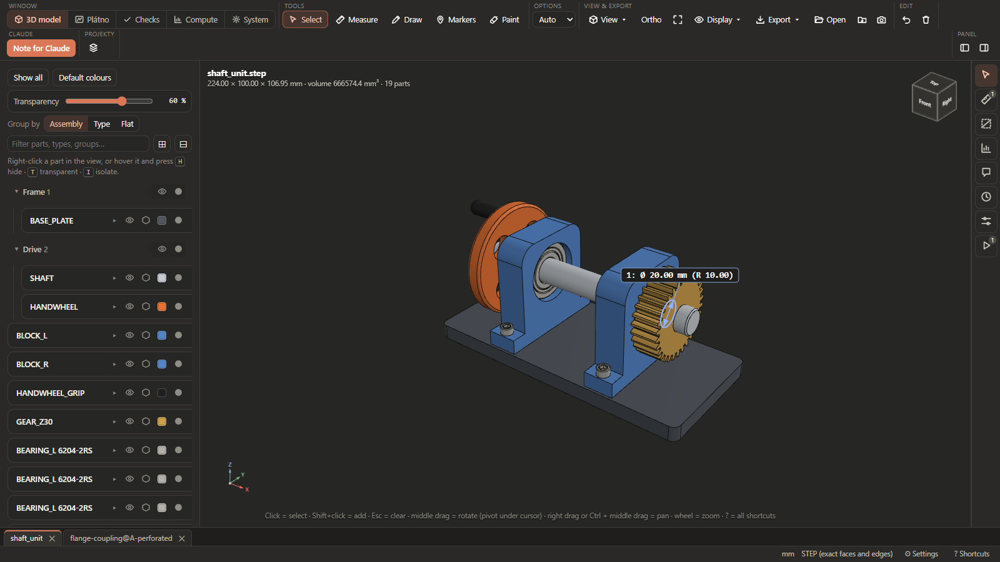
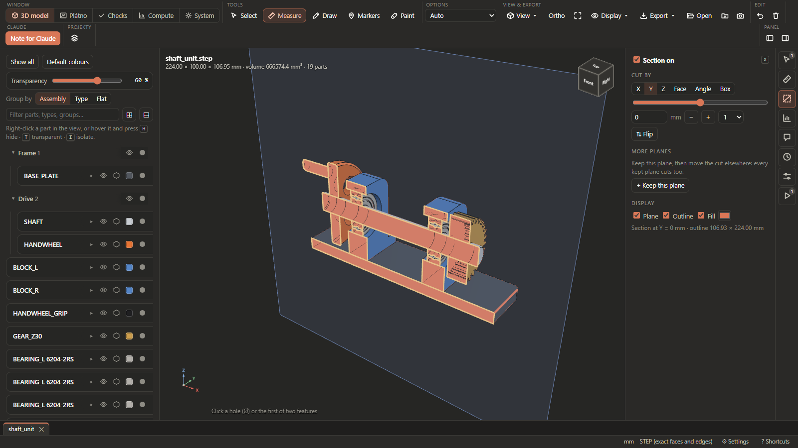
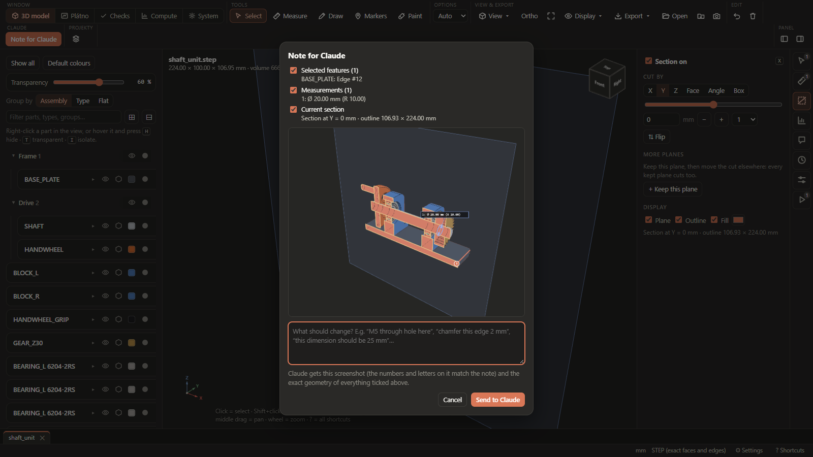
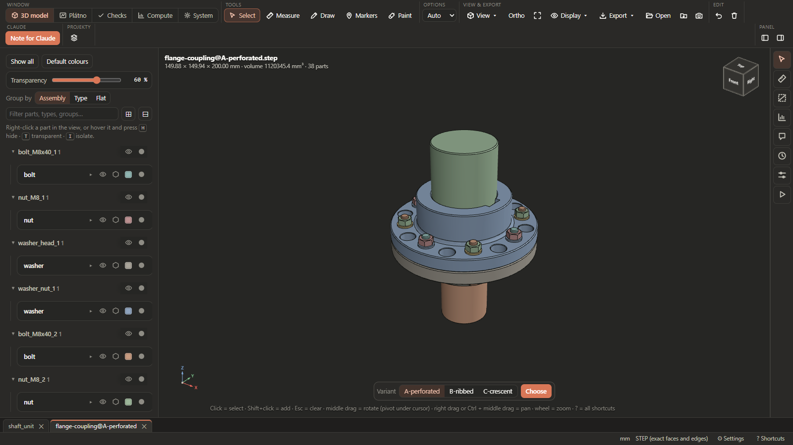
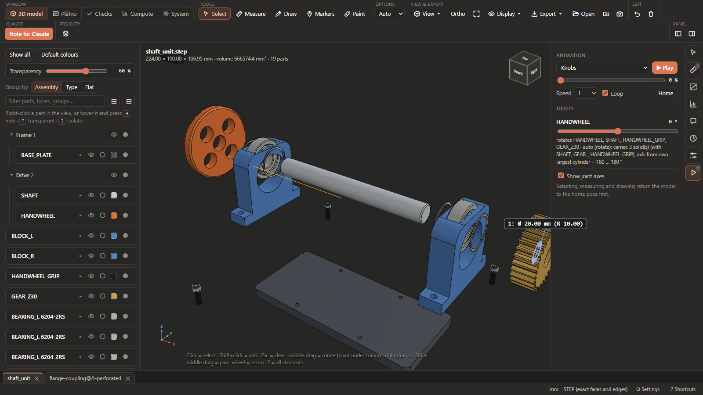
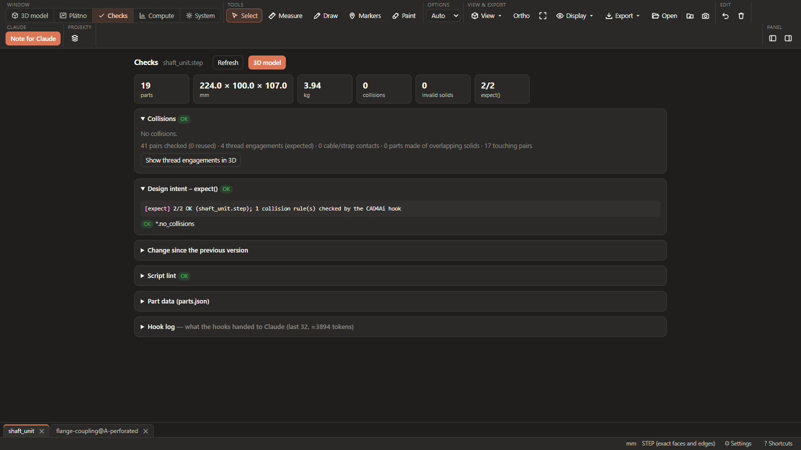
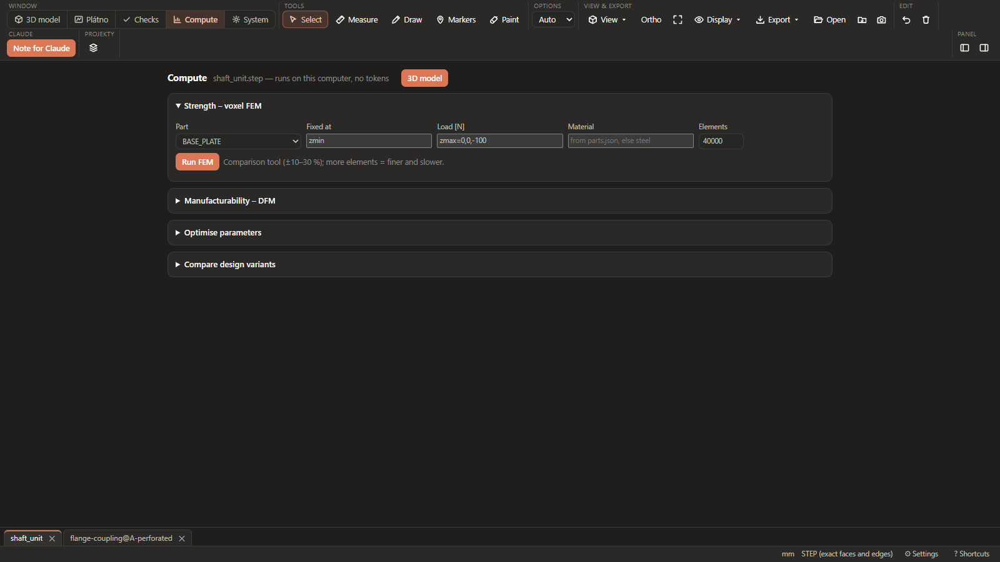

<div align="center">

# CAD4Ai

**An interactive 3D CAD workbench for Claude Code.**
Claude writes parametric CadQuery models; you inspect, measure, cut, tweak and annotate them in a real B-rep viewer
next to the chat, and your notes go straight back to Claude with the exact geometry attached.

[](CHANGELOG.md)
[](LICENSE)




</div>

---

## Contents

- [Why CAD4Ai](#why-cad4ai)
- [Features](#features)
  - [3D viewer](#3d-viewer)
  - [Talking to Claude about geometry](#talking-to-claude-about-geometry)
  - [Parameters, versions and variants](#parameters-versions-and-variants)
  - [Assemblies, motion and exploded views](#assemblies-motion-and-exploded-views)
  - [Checks and computations on your PC](#checks-and-computations-on-your-pc)
  - [Standard-part library](#standard-part-library)
  - [Sketch pad and construction canvas](#sketch-pad-and-construction-canvas)
- [Installation](#installation)
- [Quick start](#quick-start)
- [How Claude models with CAD4Ai](#how-claude-models-with-cad4ai)
- [The `cad4ai` command line](#the-cad4ai-command-line)
- [Where data is stored](#where-data-is-stored)
- [Repository layout](#repository-layout)
- [Changelog](#changelog) · [License](#license)

## Why CAD4Ai

Language models can write good CAD code, but they cannot *see* what they built, and you cannot easily point at
"this edge here". CAD4Ai closes that loop:

1. **Claude models in plain CadQuery** and exports a STEP file. The viewer reloads by itself.
2. **You work on the real B-rep**: pick exact faces, edges and vertices, measure, section, compare versions,
   move parameter sliders.
3. **You send a note** ("chamfer this edge 2 mm", "this dimension should be 25"). Claude gets a labelled
   screenshot *and* the exact geometry of everything you selected, plus the script and parameters that drive it.
4. **Heavy checks run on your PC**, not in the model's context: collisions, validity, design-intent rules,
   FEM, manufacturability. Claude receives a few lines of JSON instead of reading geometry, which saves tokens.

## Features

### 3D viewer

Opens in a pane next to the chat (`/CAD4Ai`) or standalone in any browser. STEP files are tessellated in the
browser with OpenCascade (occt-import-js) and rendered with three.js, while selection works on the exact
B-rep topology.

- **Exact selection** of faces, edges and vertices with type, size, axis and clicked point.
- **CAD-style navigation**: orbit about the point under the cursor, zoom to the cursor, grab-pan,
  view cube, saved views, orthographic and perspective modes.
- **Measure like a modern CAD**: auto mode, point–point with snapping to edge midpoints and circle centres,
  angle, Ø / R, single feature (area, length, radius), minimum distance between parts, pitch of parallel axes,
  ΔX ΔY ΔZ legs. Dimensions stay readable at any zoom and can be dragged, copied and deleted.
- **Sections**: X / Y / Z, through a face, at any angle or as a section box; several kept planes at once.
- **Analysis overlays**: wall thickness, draft angle and 3D-printing overhang, coloured on the model.
- **Paint** faces or whole parts. Notes then refer to "the purple face".
- **Markers** with a description of the feature under each point.
- **STEP colours** per face, per solid and per instance (read with OCCT XCAF).
- **Model tabs** at the bottom, like Inventor. Each tab keeps its own camera, and edits go to that model.
- **Export** to STEP (also with merged cylindrical / planar faces), IGES, BREP, STL, 3MF, OBJ, glTF / GLB,
  AMF and VRML.
- **Save project**: model, script, history, notes and a copy of the viewer in one folder that opens
  offline with `Open model.bat`.

<table>
<tr>
<td width="50%"><br><sub><b>Measure.</b> Exact Ø picked from the B-rep cylinder.</sub></td>
<td width="50%"><br><sub><b>Section.</b> A cut through the shaft axis, with filled caps and outlines.</sub></td>
</tr>
</table>

### Talking to Claude about geometry



- **Note for Claude** packs what you selected, measured, sectioned, painted and marked into one message.
  It includes a screenshot with numbered labels burnt in, so Claude sees what you see.
- The **`cad-annotate` skill** maps every note back to the exact feature in the STEP and to the line of the
  script that creates it.
- **Quick change** (right-click): one face, the parameters that drive it and one sentence.
- **Show related parameters** (right-click): finds the parameters that drive the clicked part.
- Notes keep their status (open / done) in the Notes panel.

### Parameters, versions and variants

- **Parameters panel**: every `UPPER_CASE = value  # comment [unit] min..max` line of the model script
  becomes a slider. Groups come from `# --- Name ---` lines, and you can search, pin and reset them.
  A warm CadQuery process rebuilds small models in about 0.2 s.
- **Versions**: every rebuild or export is kept (STEP and script) and can be compared in 3D or restored.
- **Design variants**: export `part@A-light.step`, `part@B-ribbed.step`, … and the viewer shows a switcher.
  You pick one, and Claude continues with it.
- **Parameter sweeps** save variants from one parameter as `model@NAME=value.step`.



### Assemblies, motion and exploded views

- **Parts tree** grouped by sub-assembly, part type or flat, driven by `<model>.parts.json`
  (type, standard, material, sub-assembly). You can hide, isolate, make transparent and recolour parts.
- **Automatic motion**: give a moving part one word in `parts.json` (`press`, `rotate`, `hinge`, `slide`).
  The PC then derives the axis, stroke and collision limits from the geometry and keeps `<model>.motion.json`
  in sync after every rebuild, with no AI step.
- **Motion tab**: joint sliders, Play / Pause, scrubbing and joint axes. The **`cad-motion` skill** writes
  linkages, gears and closed loops on request.
- **Exploded view and disassembly** (`cad-explode` skill, on request): a disassembly order that real parts
  can actually follow, with step list, trail lines and a clear verdict on what cannot come out.



### Checks and computations on your PC

The **Checks** and **Compute** windows (tabs at the top) show what the hooks hand to Claude:

- **Collisions**: exact all-pairs B-rep check, incremental and multi-core. Thread engagements, cables and
  solids of one part are listed separately, so they are not reported as false alarms.
- **Design intent**: `expect()` rules written in the script (size, holes, pitch, mass, clearance, count,
  inside, no collisions) are checked on the exported STEP after every run.
- **Diff, lint and change guard**: what the rebuild changed, script warnings, and parts that changed although
  their parameters did not.
- **Voxel FEM** with the stress drawn on the model, **DFM** (thin walls, overhangs, draft, radii),
  **parameter optimisation** and **variant comparison**.

<table>
<tr>
<td width="50%"><br><sub><b>Checks.</b> Collisions, expect() results, diff, lint and parts.json.</sub></td>
<td width="50%"><br><sub><b>Compute.</b> FEM, DFM, optimisation and variant comparison, run locally.</sub></td>
</tr>
</table>

### Standard-part library

127 families placed with one call. The geometry is real at 1:1 scale except the thread, which is split into P/2
rings and coloured.

| Group | Examples |
|---|---|
| Screws | ISO 4017 / 4014 / 4762 / 7380 / 10642, Torx, set screws, studs, threaded rod, self-tapping |
| Nuts and washers | ISO 4032 / 4035 / 7040, cap nuts, T-slot nuts, KM; ISO 7089 / 7090 / 7093, DIN 127, tab washers |
| Pins, keys, rings | ISO 2338 / 8752, clevis pins, rivets, DIN 6885 / 6888 keys, DIN 471 / 472 circlips |
| Seals | O-rings, DIN 3760 shaft seals, DIN 7603 sealing washers |
| Bearings | 60 / 62 / 63 / 618 / 619, angular contact, self-aligning, thrust, NU / NJ / N, tapered, HK needle |
| Transmission | Involute spur and helical gears, racks, sprockets |
| Profiles | IPE / HEA / HEB / HEM / IPN / UPN / UPE, L, RHS / SHS / CHS, flat and round bar, 40×40 aluminium |

```python
from cadtools.parts import place, cut, bolt_joint, apply_colors
assy.add(place("6204-2RS", at=(45, 0, 62), up=(1, 0, 0), anchor="centre"), name="BEARING_R")
block = cut(block, "ISO 4762 M6x20", "clearance", at=(45, 42, 24))   # matching hole in the mating part
```

Each part comes with counterpart tools (clearance, tapped, counterbored and countersunk holes, keyseats,
ring grooves, bearing seats). Parts you keep modelling by hand are offered as new library families.
The table values are typed from the standards and marked *unverified*: they are fine for design, but check
them against a catalogue for production.

### Sketch pad and construction canvas

- **Sketch pad** (`/sketch`, skill `cad-sketch`): an infinite canvas with a pressure-sensitive pen
  (Apple Pencil on an iPad over the LAN), marker, lasso, text and images. **Snap ✦** boxes a region; you
  describe the change and Claude redraws only that region for you to accept.
- **Construction canvas** (the *Plátno* tab, `/canvas`, skill `cad-canvas`): an engineering whiteboard with
  QuickShape+ (held strokes turn into exact lines, circles and arcs), trim, snapping, dimensions and 9 layers.
  You send a lasso selection to Claude, answer its briefing bubbles pinned to the drawing, and accept or
  reject its proposal.

## Installation

**Requirements**

- [Claude Code](https://claude.com/claude-code) (the desktop app for the viewer pane; the viewer also runs
  in any browser)
- Python 3.10+
- [CadQuery](https://cadquery.readthedocs.io/) for parameter rebuilds, exports and the local CAD tools
  (`pip install cadquery`)
- An internet connection on first start (three.js and occt-import-js load from a CDN; a saved project
  bundles them for offline use)

**Install the plugin from GitHub**

```bash
claude plugin marketplace add TheBeckeros/CAD4Ai
claude plugin install CAD4Ai@CAD4Ai --scope user
```

or from a local clone:

```bash
git clone https://github.com/TheBeckeros/CAD4Ai.git
claude plugin marketplace add ./CAD4Ai
claude plugin install CAD4Ai@CAD4Ai --scope user
```

**Run the viewer without Claude** (Windows):

```bat
start-viewer.bat "C:\path\to\model.step"
```

or anywhere: `python viewer/server.py --port 8766 --data ~/.cad4ai-viewer --open model.step`.

## Quick start

1. Ask Claude for a part: *"Model a bearing block for a 6204 bearing on a 220 × 100 base plate, M6 screws."*
2. Type `/CAD4Ai` to open the viewer. It reloads by itself after every export.
3. Click a face, write *"make this 5 mm thicker"* in **Note for Claude** and send it.
4. Move a slider in **Params** to try sizes yourself, or open **Checks** to see collisions and `expect()` results.
5. When the design is settled, ask for motion, an exploded view or a drawing.

## How Claude models with CAD4Ai

The plugin gives Claude a small set of conventions, so models stay editable in the viewer:

```python
# --- Bearing blocks ---
AXIS_H = 50.0   # shaft axis height above the base top [mm] 35..120
BLOCK_T = 24.0  # bearing block thickness along the shaft [mm] 16..40

assy = cq.Assembly(name="shaft_unit")            # unique, stable part names
assy.add(block(), name="BLOCK_L", color=...)
apply_colors(assy); assy.export("shaft_unit.step")

expect("BASE_PLATE").size(220, 100, 12)          # design intent, checked after every run
expect.no_collisions()
```

- **STEP only** by default. Other formats come from the viewer's Export menu.
- **Parameters** as `UPPER_CASE` lines with a unit and range, grouped with `# --- Group ---`.
- **Assemblies** with `cq.Assembly`, nested sub-assemblies and `<model>.parts.json` next to the STEP.
- **Threads**: external thread at the nominal diameter, tapped holes at a real tap-drill size
  (M6 → 5.0), so the overlap is a known thread engagement, not a collision.
- **Token economy**: motion files, exploded views and drawings only when you ask for them.

## The `cad4ai` command line

`python viewer/cad4ai.py <command>` returns short JSON. Claude uses it instead of writing its own analysis
scripts, and it works on its own as well.

| Command | What it does |
|---|---|
| `summary M.step` | Parts, sizes, mass and hole patterns with PCD / pitch |
| `diff M.step` | What the last rebuild changed |
| `collide M.step` | Exact collisions and clearances between all part pairs |
| `holes`, `dist`, `section`, `mass` | Feature queries, distances, SVG sections, mass properties |
| `verify M.step --level 2/3` | Validity, collisions, dimensions; level 3 adds walls, mass and FEM |
| `doctor S.py` | Why a script fails, and the largest fillet radius that still works |
| `lint S.py` | Script warnings (duplicate names, `hole(5)` for M5, missing units…) |
| `std "ISO 4762 M5x16"`, `std hole M5` | Standard parts, holes and tap drills |
| `fem`, `dfm`, `optimize` | Voxel FEM, manufacturability, parameter optimisation |
| `views M.step` | One labelled 4-view image |
| `find "bearing housing"` | Search your earlier CadQuery scripts |
| `new model.py` | Script skeleton with parameters, assembly, export and `expect()` |

Hooks run the important ones automatically: `doctor` when a script fails, `lint` after a script is written,
and diff / validity / collisions / `expect()` after every STEP export.

## Where data is stored

This folder holds only the app; working on models never writes into it. The viewer server keeps it that way:
session data aimed here is redirected to `~/.CAD4Ai/sessions`, leftovers are moved there at start, and no
`__pycache__` is written.

| What | Where |
|---|---|
| Models, design variants (`name@label.step`), side files (`.parts.json`, `.motion.json`, `.explode.json`, `.context.md`) | next to the model |
| Versions of every model (STEP + script per rebuild or export; older STEPs gzip-compressed), trimmed to *Settings → Versions kept per model* | `~/.CAD4Ai/history/<model key>/` |
| App settings | `~/.CAD4Ai/settings.json` |
| Results of the local CAD tools (digests, collisions, FEM…), trimmed to 2 GB / 60 days | `~/.CAD4Ai/cache/` |
| Stable copy of the helpers for model scripts (`sys.path.insert(0, os.path.expanduser("~/.CAD4Ai/lib"))`) | `~/.CAD4Ai/lib/` |
| Own standard-part families | `~/.CAD4Ai/library/families/` |
| Notes for Claude and their screenshots | the Claude session's folder, `<session cwd>/.CAD4Ai/s-xxx/` (a chat opened in the app folder itself uses `~/.CAD4Ai/sessions/<app>/s-xxx/`) |
| Open model tabs, pinned parameters, dimensions, paint | the browser (local storage) |

`CAD4AI_HOME` moves `~/.CAD4Ai` elsewhere. Version histories left in older session folders are moved to
`~/.CAD4Ai/history` when the viewer starts, and empty session folders older than 30 days are removed.

## Repository layout

```
.claude-plugin/   plugin and marketplace manifests
hooks/            Claude Code hooks and the viewer pane mod (register.tsx)
skills/           cad-annotate, cad-tools, cad-motion, cad-explode, cad-sketch, cad-canvas
viewer/           viewer server (server.py), web app (viewer.html, app.js), sketch pad and canvas,
                  cad4ai.py CLI and the cadtools package (checks, FEM, library, motion…)
types/            TypeScript types for the mod
docs/images/      screenshots used in this README
```

Tests: `python -m pytest viewer` and `node --test viewer/*.test.js`.

## Changelog

See [CHANGELOG.md](CHANGELOG.md).

## License

[MIT](LICENSE) © TheBeckeros
